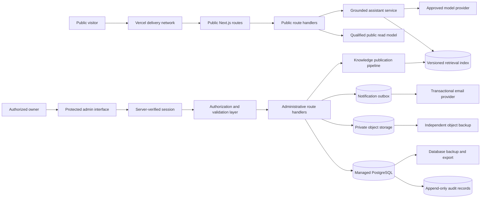
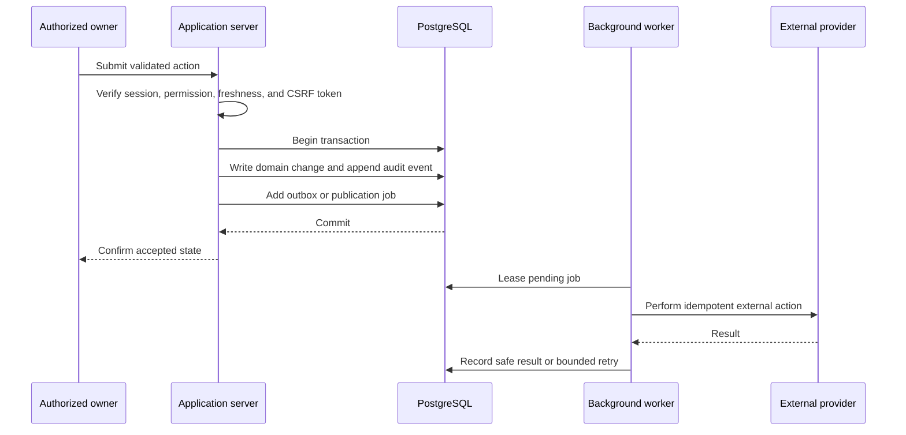

# Phase 3 secure architecture

## Decision record

- Task: T0056
- Status: approved architecture baseline
- Owner and reviewer: AKHIL
- Baseline release: Version 1.0.0 (`v1.0.0`)
- Decision date: 24 October 2026
- Next task: T0057 configures isolated development, preview, and production data services

This document defines the security and service boundaries for Phase 3. It does not
provision a service, enable paid capacity, collect production personal information,
or change the public Version 1 application.

## Architecture decision

Phase 3 will keep the existing Next.js application on Vercel and add a managed
Supabase project for each deployed environment. Supabase will provide PostgreSQL,
administrator identity, and private object storage. Resend is the preferred
transactional email provider. The existing approved language-model provider remains
behind the server-only intelligence boundary.

The browser never receives a database password, service-role credential, email API
key, model-provider key, or backup credential. Next.js Route Handlers and server
actions form the public and administrative API boundary. PostgreSQL constraints and
row-level security provide a second authorization boundary rather than relying only
on interface visibility.

This choice is conditional on T0057 confirming region, plan, limits, monthly cost,
export capability, restore capability, and owner approval before provisioning.

## System context

## Trust boundaries

| Boundary                           | Trusted side                         | Untrusted or less-trusted side           | Required controls                                                                                                               |
| ---------------------------------- | ------------------------------------ | ---------------------------------------- | ------------------------------------------------------------------------------------------------------------------------------- |
| Public browser to application      | Vercel route handlers                | Anonymous browser input                  | TLS, request schemas, origin checks where applicable, size limits, rate limits, safe errors, no privileged client secrets       |
| Admin browser to application       | Server-verified owner session        | Browser state and interface visibility   | HttpOnly secure cookies, CSRF protection, short session lifetime, re-authentication for sensitive actions, server authorization |
| Application to database            | Environment-specific server identity | Data API and database network boundary   | Pooled TLS connection, least privilege, RLS, explicit grants, constraints, statement timeouts, no service role in browser       |
| Application to storage             | Authorized server operation          | Uploaded file bytes and metadata         | Private buckets, signed short-lived access, type and size verification, quarantine, rights state, malware-scanning path         |
| Application to email               | Notification worker                  | Template input and recipient data        | Outbox, allowlisted templates, minimal payload, idempotency key, retry cap, delivery webhook verification, suppression          |
| Knowledge pipeline to active index | Owner-approved release               | Uploaded or extracted content            | Quarantine, independent review, evaluation, immutable source hash, versioned index, atomic activation, rollback                 |
| Application to model provider      | Grounded server request              | Model output and provider availability   | Minimal evidence, structured response validation, policy checks, timeout, budget limit, safe fallback, no raw enquiry content   |
| Operations to backups              | Owner-controlled recovery process    | Provider failure and accidental deletion | Encrypted export, separate access, restore drill, retention expiry, deletion propagation, recovery evidence                     |

## Component responsibilities

### Vercel application boundary

- Serve the existing public experience and the protected `/admin` interface.
- Run Next.js Route Handlers for synchronous public and administrative requests.
- Verify the authenticated user on every privileged request.
- Apply Zod request and response contracts, authorization, rate limits, CSRF checks,
  safe errors, idempotency, and audit-event creation.
- Keep static public content available when database, identity, notification, or model
  services fail.
- Run Functions in the region selected near the database in T0057.

Long-running publication, notification, retention, and backup coordination must not
depend on an open browser request. Version 1 starts with database-backed jobs and a
lease-based worker invoked by an authenticated scheduled route. A later durable queue
or workflow service may replace this mechanism without changing domain contracts.

### Supabase PostgreSQL boundary

- Store canonical villas, content versions, media metadata, knowledge governance,
  enquiries, visits, roles, notification state, retention state, and audit evidence.
- Use relational constraints for lifecycle transitions, ownership, effective dates,
  uniqueness, booking conflicts, and referential integrity.
- Keep administrative tables in a non-exposed schema when direct browser access is
  unnecessary.
- Revoke default grants and enable RLS on every table in an exposed schema.
- Use `security_invoker` views when an exposed view is necessary.
- Treat the service role as an exceptional server-only credential. Normal requests
  use the authenticated user context and database policies.
- Store authorization roles in owner-controlled profile or application metadata,
  never user-editable metadata.

### Supabase Auth boundary

- Disable public registration.
- Create the initial owner by controlled invitation.
- Use secure server-rendered session handling and verify the user on the server.
- Support TOTP multi-factor authentication before adding another active role.
- Revoke sessions before suspending or deleting an administrator.
- Require recent authentication for user management, exports, publication,
  deletion, recovery, and production release actions.
- Record safe authentication and role-management audit events without tokens or
  password material.

### Supabase Storage boundary

Use separate buckets and policies:

| Bucket class        | Access                       | Contents                                            | Publication rule                                       |
| ------------------- | ---------------------------- | --------------------------------------------------- | ------------------------------------------------------ |
| Public media        | Public read after approval   | Optimized approved images and public documents      | Only immutable approved versions receive a public path |
| Protected originals | Private                      | Source images, plans, brochures, and owner evidence | Short-lived signed access for authorized roles         |
| Quarantine          | Private and owner restricted | New or failed uploads                               | Never available to public routes or retrieval          |
| Recovery export     | Private and owner restricted | Tested object manifests and recovery packages       | Separate lifecycle and restore evidence                |

Database backups do not include stored objects. The recovery design therefore needs
an independent object manifest and object copy or export. Deleting database metadata
alone does not satisfy file deletion.

### Notification boundary

- Store a notification intent in the database before sending.
- Send only from allowlisted templates with minimum necessary data.
- Use deterministic idempotency keys to prevent duplicate delivery.
- Limit attempts, apply exponential delay, enforce quiet hours, and suppress unsafe
  or revoked destinations.
- Verify delivery webhooks and store only provider identifiers, category, delivery
  state, timestamps, and safe failure class.
- Preview sends use a sandbox or allowlisted test recipient and cannot reach real
  visitors.

### Governed knowledge boundary

The database becomes the canonical governance store. Retrieval remains a disposable
projection. Upload, extraction, review, evaluation, and activation are separate
states. Only an owner-approved release can atomically change the active index pointer.
The prior active index remains available for immediate rollback.

Raw enquiries, private notes, contact details, conversations, and voice audio never
enter the knowledge package or retrieval index.

## Data classification

| Class             | Examples                                                             | Storage and access rule                                                                   |
| ----------------- | -------------------------------------------------------------------- | ----------------------------------------------------------------------------------------- |
| Public            | Published villa facts, approved pages, public media                  | Public read from a qualified published version                                            |
| Internal          | Draft content, review notes, non-sensitive operational configuration | Authorized roles only with audited changes                                                |
| Personal          | Enquiry contact details, visit requests, assignments                 | Production only, purpose-limited access, retention clock, encrypted transport and storage |
| Restricted        | Credentials, session tokens, service keys, recovery secrets          | Provider secret store only, never application records or logs                             |
| Security evidence | Audit category, actor, target, result, timestamp                     | Append-only access, owner and auditor visibility, content minimized                       |

## Authorization model

1. Middleware may redirect unauthenticated users, but it is not the authorization
   authority.
2. Every route handler verifies the session and calls a central permission function.
3. The permission decision uses server-controlled role assignments and resource
   scope.
4. Database grants and RLS enforce the same restriction on affected rows.
5. Sensitive actions require a fresh session and create an audit event in the same
   transaction as the domain change when possible.
6. Publication, role change, export, deletion, knowledge activation, migration,
   restore, and release remain owner-only in the initial MVP.

## Write and publication pattern

No email, index activation, or other external side effect occurs before the owning
database transaction commits.

## Environment and deployment boundaries

| Environment | Application                                | Data service                                | Storage                      | Notifications                      | Data rule                                  |
| ----------- | ------------------------------------------ | ------------------------------------------- | ---------------------------- | ---------------------------------- | ------------------------------------------ |
| Local       | Local Next.js                              | Local stack or isolated development project | Synthetic files only         | Stubbed or captured locally        | Synthetic records only                     |
| Preview     | Protected Vercel deployment                | Dedicated preview project                   | Dedicated test buckets       | Sandbox and allowlisted recipients | Synthetic or explicitly approved test data |
| Production  | Public and protected production deployment | Dedicated production project                | Dedicated production buckets | Verified production sender         | Approved operational data only             |

Environment credentials, origins, signing secrets, databases, buckets, senders, and
webhook endpoints are distinct. Production data is never copied to preview or local.
Schema migrations run against preview first with forward, rollback, backup, and
restore evidence. The exact accepted production artifact is promoted without rebuild.

## Failure strategy

| Failure                        | Public behaviour                                                                            | Administrative behaviour                                                                 | Recovery action                                                             |
| ------------------------------ | ------------------------------------------------------------------------------------------- | ---------------------------------------------------------------------------------------- | --------------------------------------------------------------------------- |
| Database unavailable           | Static Version 1 pages stay available; changing facts show no stale administrative override | Writes fail closed and preserve the submitted draft in the browser only when safe        | Alert owner, stop workers, restore service, verify migrations and data      |
| Authentication unavailable     | Public site remains available                                                               | New sign-ins fail; existing privileged operations require successful server verification | Use provider status and owner recovery runbook; never bypass authentication |
| Storage unavailable            | Existing cached approved public media may remain visible                                    | Upload, replacement, and signed protected download stop safely                           | Reconcile object manifest after recovery                                    |
| Email unavailable              | Contact routes remain visible                                                               | Notification intent remains queued with bounded retry; no duplicate send                 | Resume from outbox using the same idempotency key                           |
| Model unavailable or throttled | Existing safe assistant fallback and normal navigation remain available                     | Knowledge publication cannot activate if required evaluation is incomplete               | Restore capacity or approved fallback and repeat evaluation                 |
| Index activation failure       | Last-known-good index remains active                                                        | Candidate release becomes failed and cannot publish                                      | Repair candidate, rerun evaluation, or roll back pointer                    |
| Deployment regression          | Known-good public deployment remains the rollback target                                    | Administrative writes may enter maintenance mode                                         | Roll back application, verify data compatibility, then reopen writes        |
| Backup or restore failure      | No direct public disclosure                                                                 | Production release and destructive changes are blocked                                   | Repair backup path and complete a documented restore exercise               |

## Recovery objectives

The initial design targets a four-hour recovery time objective and a 24-hour recovery
point objective for the Phase 3 MVP. T0057 must verify that the selected service plan
can meet these values. A daily database backup alone cannot meet the target for file
objects, so independent object recovery is mandatory. A later owner decision may
tighten these objectives after cost review and measured restore tests.

Required recovery evidence includes:

- logical database export and provider-managed backup status;
- protected-object manifest with hash, size, bucket, version, and rights metadata;
- active and previous knowledge index packages;
- schema migrations, configuration inventory, and secret names without values;
- a timed preview restoration with row counts, object hashes, authorization tests,
  assistant evaluation, and owner sign-off.

## Security invariants

- Public registration stays disabled.
- Interface visibility never grants permission.
- No privileged credential reaches the browser.
- No unapproved upload reaches public storage or the active retrieval index.
- No changing price or availability becomes public without authority and a current
  verification date.
- No external notification sends before the owning transaction commits.
- No ordinary administrator can update or delete audit history.
- No production personal data enters local or preview environments.
- No release proceeds after a critical or high-severity finding or a failed restore.

## T0057 handoff

T0057 must validate and record the exact Supabase, Vercel, and Resend configuration,
regions, plan limits, cost controls, project separation, bucket policy, sender domain,
backup method, and restore procedure before creating production resources. No paid
plan or real-data collection is implied by this architecture decision.
